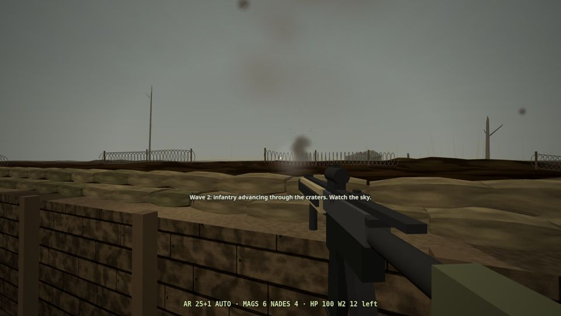

# TRENCH LINE VR

Modern trench warfare VR game for Meta Quest (WebXR, three.js). Hold a muddy front-line trench against three waves: dug-in riflemen, a crater-to-crater advance with FPV drones, and an assault down your own trench. Fictional setting.

## Play
1. On your Meta Quest 3/3S, open **Quest Browser**.
2. Go to **https://officialdrexie-11.github.io/trench-vr/**
3. Tap **Enter VR**. (Desktop browsers: click **Play on desktop**.)

## Quest controls
- Right trigger: fire / click menu
- Left grip near handguard: two-hand grip
- Right A: drop mag · B: bolt release / semi-auto
- Left grip at chest pouch: grab mag → push into magwell
- Left grip on charging handle, pull back: chamber
- Left grip at left hip: grenade · left trigger: pull pin · release grip: throw
- Right grip at right hip: rifle ⇄ pistol
- Left stick: move (click = sprint) · right stick: turn
- X: light/laser · Y: menu · right stick click: LPVO zoom
- Grip a crate: resupply

## Desktop controls
Click to lock mouse · WASD move · Shift sprint · LMB fire · RMB aim · R reload · B bolt release / fire mode · 1/2 rifle/pistol · G grenade · F light/laser · V LPVO zoom · C crouch · E resupply at crate · N rain · M / Esc menu

Static site: no build step. Served by GitHub Pages from the `main` branch root.
